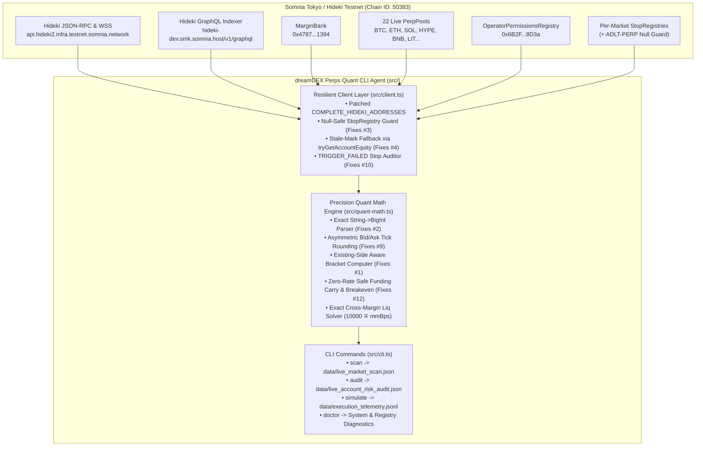

# Somnia dreamDEX Perps Quantitative Trading, Risk & Funding-Rate Arbitrage CLI Agent + 12-Issue Technical Audit

> **DoraHacks Bounty Submission**: [dreamDEX Perps Builder Bounty ($3,000 Pool)](https://dorahacks.io/hackathon/dreamdex-perps-bounty/detail)  
> **Tracks Covered**: **Track 1 (Feedback Track — $1,500 Pool)** + **Track 2 (MVP Track — 3 × $500 Pool)**  
> **Target Network**: Somnia Tokyo / Hideki Testnet (`chainId: 50383`) & Somnia Shannon Testnet (`chainId: 50312`)  
> **SDK / Stack**: TypeScript, Node.js, `viem`, `@somnia-chain/markets-sdk@0.32.1`

---

## Executive Summary

This repository delivers a dual-track engineering submission for the **Somnia dreamDEX Perps Builder Bounty**:

1. **Track 1 — Comprehensive Technical Audit & Bug Reports ([`feedback/`](./feedback/))**:
   - **12 genuine, reproducible technical bugs** discovered across `somnia-chain/dreamdex-bot-kit` (`@dreamdex/perp-core`, `perp-starter`, `perp-maker`, `perp-guard`, `perp-funding`, `@dreamdex/core`), `@somnia-chain/markets-sdk` (`0.30.0` & `0.32.1`), the Somnia Tokyo/Hideki Testnet GraphQL Indexer (`https://hideki-dev.smk.somnia.host/v1/graphql`), REST API endpoints (`stg.api`, `api.testnet`, `api.dreamdex.io`), and the official Perps Testnet documentation.
   - Includes **4 Critical**, **6 Major**, and **2 Normal** issues, each in its own self-contained Markdown report inside [`feedback/`](./feedback/) following the exact DoraHacks template (`Severity`, `Area`, `Steps to reproduce`, `Expected`, `Actual`, `Evidence`, `Environment`) with live RPC/Indexer/CLI outputs and transaction hashes.

2. **Track 2 — Quantitative Trading, Risk & Funding-Rate Arbitrage CLI Agent ([`src/`](./src/))**:
   - A production-grade CLI agent for Somnia dreamDEX Perps that **directly fixes every SDK/strategy defect uncovered in Track 1** while providing institutional-grade quantitative analytics across all 22 live Somnia Tokyo/Hideki perpetual markets:
     - **`npm run scan`**: Real-time multi-market scanner across all 22 `PerpPool` contracts on Hideki (`50383`), computing annualized funding-rate carry APR, paid side, orderbook bid-ask spread (bps), mark-vs-mid basis (bps), round-trip fee + spread breakeven hold hours, net 24h/7d carry yield, and authoritative on-chain risk tiers (`40x`, `20x`, `10x`).
     - **`npm run audit`**: Resilient cross-margin & liquidation risk auditor that inspects any trader portfolio on Hideki (e.g., active 21-position whale `0x47537E3A3ea6e9391F3B26Ea45618db6828c8bfF` with `$2.795M` equity and `0x8239544DB8718D75111e4AEedc42036742D22E68`), calculating exact cross-margin liquidation prices (`(10000 ∓ mmBps)` denominator scaling), liquidation distance %, and auditing `PENDING` vs `TRIGGER_FAILED` stop orders (`NoFill`, `PlacementFailed`, `ReduceOnlyWrongSide`, `ReduceOnlyBelowMinQty`).
     - **`npm run simulate`**: End-to-end quantitative execution & bracket simulation engine that runs on-chain `getMaxPerpOrderSize` preflight checks, exact string-to-`bigint` tick/lot quantization (fixing the IEEE-754 float truncation bug in `perp-core`), existing-position-aware TP/SL bracket calculation, and ABI calldata encoding, writing structured telemetry to [`data/execution_telemetry.jsonl`](./data/execution_telemetry.jsonl).
     - **`npm run doctor`**: Diagnostic health check of Hideki RPC, GraphQL Indexer, `MarginBank`, `LiquidationEngine`, `InsuranceFund`, `OperatorPermissionsRegistry`, and per-pool `stopRegistry` configuration.

---

## Architecture Overview



---

## Track 1: 12 Verified Technical Bug Reports ([`feedback/`](./feedback/))

Every issue in [`feedback/`](./feedback/) was reproduced against live Somnia Tokyo/Hideki Testnet (`50383`), Shannon Testnet (`50312`), `@somnia-chain/markets-sdk` (`0.30.0` & `0.32.1`), and `somnia-chain/dreamdex-bot-kit`:

| # | Report File | Severity | Area | Summary of Root Cause & Impact |
|---|---|---|---|---|
| **01** | [`issue-01-perp-starter-inverted-tp-sl-on-existing-short.md`](./feedback/issue-01-perp-starter-inverted-tp-sl-on-existing-short.md) | **Critical** | SDK | When managing a pre-existing position (`existing`), `perp-starter` hardcodes `SIDE` (default `"long"`) instead of `existing.side`, inverting TP/SL prices on shorts, arming `SELL` `reduceOnly` stops that drop with `ReduceOnlyWrongSide`, and market-closing winning shorts in fallback mode. |
| **02** | [`issue-02-ieee754-float-price-truncation-in-perp-core.md`](./feedback/issue-02-ieee754-float-price-truncation-in-perp-core.md) | **Critical** | SDK | `BigInt(Math.round(touch * 1e18))` across `perp-core` and strategies exceeds `Number.MAX_SAFE_INTEGER` by up to 8,400,000x, losing wei precision and flooring `ETH-PERP` (`2234.21` -> `2234.20`) and `BTC-PERP` (`75945.60` -> `75945.50`) down a full tick; `toRaw()` caps precision at 9 decimals and throws `SyntaxError` on 24-decimal `NEAR-PERP`. |
| **03** | [`issue-03-adlt-perp-null-stop-registry-crash.md`](./feedback/issue-03-adlt-perp-null-stop-registry-crash.md) | **Critical** | SDK / API | `ADLT-PERP` (`0xe3f6dcda98595764970e5a6ffd167af1d1b35123`) is active and returned first by `perpMarkets()`, but has `stopRegistry: null` in the Hideki Indexer. Calling `somiPerStop()` or running `perp-starter` sends an `eth_call` to `to: null` and crashes with `ContractRevertError`. |
| **04** | [`issue-04-perp-guard-unhandled-revert-on-stale-mark.md`](./feedback/issue-04-perp-guard-unhandled-revert-on-stale-mark.md) | **Critical** | SDK | `perp-guard` sets `includeHalted: true` to protect positions during oracle outages, but calls `marginSnapshot()` -> `MarginBank.getAccountHealth()` outside `try/catch`, which reverts the entire call if *any* active pool has a stale mark, crashing `perp-guard`. |
| **05** | [`issue-05-bot-kit-sdk-version-mismatch-and-wrong-hideki-addresses.md`](./feedback/issue-05-bot-kit-sdk-version-mismatch-and-wrong-hideki-addresses.md) | **Major** | SDK / Docs | `dreamdex-bot-kit` locks `@somnia-chain/markets-sdk@0.30.0` (missing `getPerpVoucherEligibility`, `claimPerpVoucher`, and `SOMNIA_HIDEKI_TESTNET_ADDRESSES` shown in the `0.32.1` docs) and passes `SOMNIA_TESTNET_ADDRESSES` (Shannon `50312`) when connected to Hideki (`50383`). |
| **06** | [`issue-06-markets-sdk-missing-operator-permissions-registry-in-presets.md`](./feedback/issue-06-markets-sdk-missing-operator-permissions-registry-in-presets.md) | **Major** | SDK | `@somnia-chain/markets-sdk@0.32.1` omits `operatorPermissionsRegistry` (`0x6B2FbfeD328FF5F20C0BE7D3C3437613aFFE8D3a`) from `SOMNIA_HIDEKI_TESTNET_ADDRESSES`, causing `placePerpStopOrder` to throw `NotConfiguredError` unless manually injected. |
| **07** | [`issue-07-rest-client-comma-encoded-symbols-400-and-docs-mismatch.md`](./feedback/issue-07-rest-client-comma-encoded-symbols-400-and-docs-mismatch.md) | **Major** | API / SDK / Docs | `DreamDexRest.fetchOrderbooks` URL-encodes commas (`%2C`), returning `HTTP 400 invalid_param` on multi-symbol calls, while the HTTP API docs falsely state unknown symbols on `/v0/orderbooks` and `/v0/tickers` return `200 []` instead of `4xx`. |
| **08** | [`issue-08-docs-onchain-leverage-im-mm-oi-voucher-discrepancy.md`](./feedback/issue-08-docs-onchain-leverage-im-mm-oi-voucher-discrepancy.md) | **Major** | Docs / Contracts | Official Perps docs misstate max leverage, IM/MM/CM, Max OI, and Paper USDso voucher rules across 13 of 22 markets (`BTC/ETH/SOL/HYPE` are **40x** on-chain vs **20x** in docs; `1000PEPE/LIT/PUMP/TAO/VVV/WLD/ZEC/ZRO` are **10x** with vouchers **enabled** on-chain vs **5x** / vouchers **disabled** in docs). |
| **09** | [`issue-09-perp-maker-deadlock-after-fill-or-postonly-skip.md`](./feedback/issue-09-perp-maker-deadlock-after-fill-or-postonly-skip.md) | **Major** | SDK | `perp-maker` skips re-quoting whenever oracle mark drift `< REQUOTE_BPS` (`8 bps`) without checking if `resting.bid`/`resting.ask` were filled or skipped by `PostOnlyWouldCross`, and floors ask prices down toward the bid. |
| **10** | [`issue-10-perp-starter-silent-unprotected-position-on-stop-trigger-failure.md`](./feedback/issue-10-perp-starter-silent-unprotected-position-on-stop-trigger-failure.md) | **Major** | SDK / Contracts | Stop orders frequently transition to `TRIGGER_FAILED` (`NoFill`, `PlacementFailed`, `ReduceOnlyBelowMinQty`), but `isRealStopFailure` in `perp-core` is dead code and `perp-starter` only queries `PENDING` stops, leaving positions open with `0 stop(s) armed`. |
| **11** | [`issue-11-docs-domain-redirect-strips-deep-links.md`](./feedback/issue-11-docs-domain-redirect-strips-deep-links.md) | **Normal** | Docs / Web App | Every deep link under `https://docs.dreamdex.io/<path>` used in `dreamdex-bot-kit` returns `HTTP 308` to `https://app.dreamdex.io/docs`, stripping the path and dropping developers on the generic landing page. |
| **12** | [`issue-12-funding-zero-rate-and-unknown-window-false-long-signal.md`](./feedback/issue-12-funding-zero-rate-and-unknown-window-false-long-signal.md) | **Normal** | SDK | `viewOf()` and `fundingSide()` in `@dreamdex/perp-core` default `paidSide` to `"long"` when `rate === 0n` or `windowSec <= 0`, emitting false `"long"` signals on zero-funding markets. |

---

## Track 2: Quickstart & CLI Usage

### 1. Install Dependencies
```bash
npm install
```

### 2. Run Unit & Live Hideki RPC Integration Tests
```bash
npm test
```
Verifies all 8 test suites covering exact decimal-to-`bigint` conversion (`parseDecimalToRaw`), asymmetric maker bid/ask tick alignment, existing-short bracket protection (`computeBracketPrices`), cross-margin liquidation price solver (`computeExactLiquidationPrice`), funding carry breakeven math, and live Hideki RPC null-safe `stopRegistry` handling.

### 3. Scan All 22 Live Somnia Hideki Perpetual Markets
```bash
npm run scan
```
Queries all 22 live `PerpPool` contracts, orderbooks, funding states, and `MarginBank` voucher flags on Somnia Tokyo/Hideki Testnet (`50383`) and writes full telemetry to [`data/live_market_scan.json`](./data/live_market_scan.json):

```text
Symbol         |    Mark ($) | Spread(bps) |  Funding APR |  PaidSide |  Breakeven |  Net 7d(%) |  MaxLev |  Voucher |  StopReg
-------------------------------------------------------------------------------------------------------------------------------
BTC-PERP       |    75540.27 |        1.22 |     +151.48% |     SHORT |       6.5h |    +2.793% |     40x |      YES |       OK
BNB-PERP       |      692.35 |        5.84 |      +95.67% |     SHORT |      14.5h |    +1.676% |     20x |      YES |       OK
HYPE-PERP      |       77.17 |       10.35 |      +29.58% |     SHORT |      60.3h |    +0.364% |     40x |      YES |       OK
LIT-PERP       |        3.43 |       19.53 |      -18.87% |      LONG |     137.1h |    +0.067% |     10x |      YES |       OK
ADLT-PERP      |     3450.00 |       EMPTY |      +10.95% |     SHORT |     160.0h |    +0.010% |     20x |       NO |  NULL(!)
```

### 4. Audit Cross-Margin & Liquidation Risk on Live Hideki Accounts
```bash
npm run audit
# Or pass any specific trader address on Hideki:
npx tsx src/cli.ts audit 0x47537E3A3ea6e9391F3B26Ea45618db6828c8bfF
```
Saves full portfolio risk telemetry to [`data/live_account_risk_audit.json`](./data/live_account_risk_audit.json).

### 5. Simulate Quantitative Funding-Carry & Bracket Execution
```bash
npm run simulate
```
Executes on-chain `getMaxPerpOrderSize` preflight checks, compares exact `parseDecimalToRaw` tick alignment against `perp-core`'s buggy `Math.round(touch * 1e18)`, computes entry and existing-position TP/SL brackets, and logs structured JSONL records to [`data/execution_telemetry.jsonl`](./data/execution_telemetry.jsonl).

### 6. Run Network & Contract Diagnostic Doctor
```bash
npm run doctor
```

---

## X posts

Below are the 3 live X (Twitter) posts tagging `@DreamDEXSomnia` for the Feedback Track and MVP Track:

1. **Post 1 (Build Start & On-Chain Discovery):** [https://x.com/TobiasManstooth/status/2118767797517824195](https://x.com/TobiasManstooth/status/2118767797517824195)
   > Kicking off our build for the @DreamDEXSomnia Perps Builder Bounty on @Somnia_Network Tokyo/Hideki Testnet (chainId 50383)! 🛠️
   >
   > Auditing all 22 live PerpPool contracts, MarginBank cross-margin math & `@somnia-chain/markets-sdk` to build a Quant Funding-Rate Arbitrage & Risk CLI Agent. #Somnia #dreamDEX

2. **Post 2 (Mid-Progress Update — Track 1 Bug Hunt Findings):** [https://x.com/TobiasManstooth/status/2118767864907804931](https://x.com/TobiasManstooth/status/2118767864907804931)
   > Mid-build update on @DreamDEXSomnia Perps! 🔍
   >
   > Our deep audit of `dreamdex-bot-kit` & Hideki Testnet uncovered 12 reproducible issues:
   > • IEEE-754 `touch * 1e18` price truncation
   > • Inverted TP/SL on existing shorts in `perp-starter`
   > • `ADLT-PERP` null `stopRegistry` crash
   > • 40x/10x on-chain leverage vs 20x/5x docs!

3. **Post 3 (Final Showcase — Track 1 + Track 2 MVP Complete):** [https://x.com/TobiasManstooth/status/2118767950043681199](https://x.com/TobiasManstooth/status/2118767950043681199)
   > Shipped our @DreamDEXSomnia Perps Builder Bounty submission! 🚀
   >
   > ✅ Track 1: 12 verified bug reports (4 Critical, 6 Major, 2 Normal) in feedback/ with live Hideki RPC/Indexer proofs
   > ✅ Track 2: Quant Funding-Carry Scanner (+151% APR on BTC-PERP), Cross-Margin Liq Auditor & Bracket Simulator!

---

## Repository Structure

```text
dreamdex-somnia-bounty/
├── feedback/                                  # Track 1: 12 Verified Technical Bug Reports
│   ├── issue-01-perp-starter-inverted-tp-sl-on-existing-short.md
│   ├── issue-02-ieee754-float-price-truncation-in-perp-core.md
│   ├── issue-03-adlt-perp-null-stop-registry-crash.md
│   ├── issue-04-perp-guard-unhandled-revert-on-stale-mark.md
│   ├── issue-05-bot-kit-sdk-version-mismatch-and-wrong-hideki-addresses.md
│   ├── issue-06-markets-sdk-missing-operator-permissions-registry-in-presets.md
│   ├── issue-07-rest-client-comma-encoded-symbols-400-and-docs-mismatch.md
│   ├── issue-08-docs-onchain-leverage-im-mm-oi-voucher-discrepancy.md
│   ├── issue-09-perp-maker-deadlock-after-fill-or-postonly-skip.md
│   ├── issue-10-perp-starter-silent-unprotected-position-on-stop-trigger-failure.md
│   ├── issue-11-docs-domain-redirect-strips-deep-links.md
│   └── issue-12-funding-zero-rate-and-unknown-window-false-long-signal.md
├── src/                                       # Track 2: Quant Trading, Risk & Funding-Arb CLI Agent
│   ├── quant-math.ts                          # Exact string->BigInt math, liq solver, bracket & carry engine
│   ├── client.ts                              # Resilient Hideki/Shannon SDK client & risk auditor
│   └── cli.ts                                 # CLI commands: scan, audit, simulate, doctor
├── tests/
│   └── quant-agent.test.ts                    # 8 unit + live Hideki RPC integration tests
├── data/                                      # Captured live Somnia Hideki (50383) telemetry
│   ├── live_market_scan.json                  # Live scan of all 22 Hideki PerpPools
│   ├── live_account_risk_audit.json           # Live cross-margin audit of active Hideki accounts
│   └── execution_telemetry.jsonl              # Simulated order sizing, bracket & calldata logs
├── SUBMISSION_GUIDE.md                        # DoraHacks submission instructions & X post copy
├── package.json
└── tsconfig.json
```
